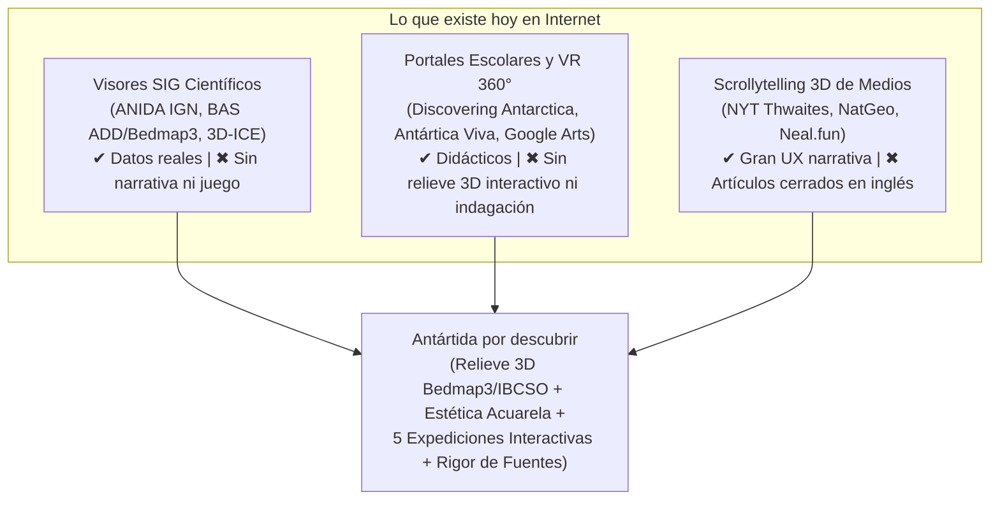

# Investigación: Aplicaciones Similares sobre la Antártida y Estado del Arte en Turismo Educativo Interactivo

Esta investigación releva el ecosistema actual de plataformas interactivas sobre la Antártida (en Argentina, Latinoamérica y el mundo) y los referentes globales del **estado del arte en turismo educativo, cartografía 3D narrativa y divulgación científica**, contrastándolos con la propuesta de **Antártida por descubrir** ([`README.md`](../README.md), [`ROADMAP.md`](../ROADMAP.md)).

---

## 1. Hallazgo Principal: El vacío que llena *Antártida por descubrir*

> [!IMPORTANT]
> **Conclusión clave para el producto y para el pitch (Criterio de Innovación - 15 pts y Pertinencia - 25 pts):**
> En internet hoy existen dos extremos desconectados sobre la Antártida:
> 1. **Visores SIG científicos duros** (como ANIDA del IGN o los visores de Bedmap3 del BAS): tienen datos reales extraordinarios pero interfaces técnicas pensadas para especialistas, sin narrativa ni mecánicas didácticas.
> 2. **Portales escolares o recorridos 360° pasivos** (como *Discovering Antarctica* o *Google Street View*): son accesibles pero usan mapas planos estáticos, videos o textos enciclopédicos.
>
> **No existe hoy una aplicación web abierta en español (y menos aún con perspectiva bicontinental desde Ushuaia) que combine:**
> - Relieve 3D científico real (**Bedmap3** + **IBCSO v2**) renderizado en el navegador con **estética editorial ilustrada (acuarela, tinta, hachures y curvas de nivel)**;
> - **Expediciones guiadas por indagación** (*Explorar → Descubrir → Profundizar*) con micro-interacciones táctiles y por teclado; y
> - **Transparencia epistemológica explícita** en la interfaz (*Dato real* vs. *Simulación educativa* vs. *Reconstrucción artística*).

---

## 2. Aplicaciones y Plataformas sobre la Antártida

### 2.1. En Argentina y la Región (Perspectiva Austral / Bicontinental)

| Proyecto / Institución | Qué hace | Similitudes y diferencias con nuestro proyecto | Fuente / Referencia (consultado: 11/11/2026) |
| :--- | :--- | :--- | :--- |
| **ANIDA — Atlas Nacional Interactivo de la Antártida** *(Instituto Geográfico Nacional + Instituto Antártico Argentino)* | Primer atlas geográfico digital interactivo del Sector Antártico Argentino. Reúne capas SIG, bases científicas, glaciología, historia y mirada bicontinental. | **Similitud:** Rigor oficial argentino y enfoque bicontinental. **Diferencia:** Es un visor cartográfico/enciclopédico tradicional (2D SIG y artículos), no una experiencia 3D inmersiva ni gamificada por preguntas. **Oportunidad:** Excelente fuente primaria verificada para nuestras expediciones (*Orcadas*, *Desde Ushuaia*). | https://antartida-anida.ign.gob.ar (IGN / IAA) |
| **Antártica Viva (*Living Antarctica*)** *(Instituto Milenio BASE, Chile)* | Mapa interactivo web de divulgación sobre biodiversidad antártica y subantártica, acompañado de fichas de especies y recursos escolares. | **Similitud:** Busca acercar la ciencia antártica a estudiantes y público general mediante un mapa ilustrado con puntos de interés. **Diferencia:** Es un mapa 2D ilustrado con fichas informativas estáticas, sin relieve 3D real ni mecánicas de laboratorio/excavación. | https://institutobase.cl (Instituto Milenio BASE) |
| **Museo Marítimo y Museo Antártico «José M. Sobral» + Pampa Azul** *(Ushuaia / Estado Nacional)* | El Museo en Ushuaia combina maquetas navales, fósiles y reliquias históricas con desafíos educativos presenciales; *Pampa Azul* articula divulgación del Atlántico Sur. | **Similitud:** Comparten exactamente los ejes temáticos (expediciones históricas, cruce desde Ushuaia, soberanía científica, océano austral). **Diferencia:** Sus propuestas interactivas son mayormente presenciales o infográficas; no cuentan con un atlas 3D web interactivo como el nuestro. | https://museomaritimo.com (Museo Marítimo de Ushuaia) / https://www.pampazul.gob.ar (Iniciativa Pampa Azul) |

### 2.2. A Nivel Internacional

| Proyecto / Institución | Qué hace | Qué podemos tomar de idea | Fuente / Referencia (consultado: 11/11/2026) |
| :--- | :--- | :--- | :--- |
| **Discovering Antarctica** *(British Antarctic Survey + Royal Geographical Society, UK)* | El portal educativo escolar más completo sobre la Antártida. Incluye módulos interactivos sobre clima, glaciares, cadenas tróficas, historia y turismo. | **Idea a tomar:** Sus micro-actividades basadas en preguntas concretas (ej. *«¿Qué llevarías en el buque?»* o *«¿Quién se come a quién en el Océano Austral?»*) funcionan muy bien sin requerir mecánicas complejas. | https://discoveringantarctica.org.uk (BAS / RGS-IBG) |
| **3D ICE & BAS Bedmap3 Scene Viewers** *(3D-ICE / British Antarctic Survey / ArcGIS)* | Visores WebGL científicos que permiten ver la topografía subglacial de la Antártida (Bedmap2/Bedmap3 y BedMachine) quitando la capa de hielo en 3D. | **Idea a tomar:** Mostrar el contraste entre la **superficie de hielo actual** y el **lecho rocoso subglacial** (o cuánto mide el domo de hielo en comparación con una montaña conocida) refuerza el asombro sobre los datos reales de Bedmap3 que ya usamos en [`packages/core/src/relief.ts`](../packages/core/src/relief.ts). | https://www.bas.ac.uk/project/bedmap/ (British Antarctic Survey) |
| **AntarctiX: Be the Hero of the Ice** *(University of Tasmania, Australia)* | Juego web educativo tipo *«Elige tu propia aventura»* donde estudiantes asumen el rol de científicos a bordo del rompehielos *RSV Nuyina*. | **Idea a tomar:** Poner a la persona usuaria en primera persona como parte del equipo de expedición (tomar una decisión de ruta o formular una hipótesis antes de ver la respuesta, tal como ya hace el paso 3 de *Fósiles* en [`docs/diseno/HANDOFF.md`](diseno/HANDOFF.md)). | https://www.utas.edu.au (University of Tasmania) |
| **Antarctica 360 VR & Endurance22 Digital Twin** *(Antarctic Heritage Trust NZ / Falklands Maritime Heritage Trust)* | Recorridos virtuales por cabañas históricas (Scott, Shackleton) y escaneo fotogramétrico 3D milimétrico del naufragio del *Endurance* con pines informativos sobre objetos reales. | **Idea a tomar:** El patrón de **«inspección de evidencia con pines A/B/C»** sobre una escena histórica o reconstrucción (que ya tenemos en el paso 4 de *Fósiles*) es ideal para contar historias reales en **Orcadas** (el observatorio magnético/meteorológico de 1904) y **Poncho**. | https://nzaht.org (Antarctic Heritage Trust) / https://endurance22.org (FMHT) |

---

## 3. Estado del Arte Mundial en Turismo Educativo y Cartografía Narrativa

Fuera de la temática exclusivamente antártica, estas son las aplicaciones web que hoy definen el estado del arte internacional y cómo se conectan con nuestras **5 expediciones** ([`ROADMAP.md`](../ROADMAP.md)):

### 3.1. *The Deep Sea* (Neal.fun) y *Dive and Discover* (Woods Hole - WHOI) → Inspiración para la expedición **«Océano»**
- **Por qué son estado del arte:** *The Deep Sea* (de Neal Agarwal, https://neal.fun/deep-sea/, consultado 11/11/2026) transformó la divulgación oceánica en la web con una mecánica mínima: a medida que bajás en profundidad, ves qué especies viven en cada estrato, cómo cambia la luz y la temperatura, y qué hitos humanos o geológicos existen a esa cota. *Dive and Discover* (Woods Hole Oceanographic Institution, https://divediscover.whoi.edu/, consultado 11/11/2026) lo complementa con bitácoras reales de campañas oceanográficas.
- **Cómo aplicarlo en «Océano»:**
  - En lugar de solo texto sobre el Océano Austral y la Corriente Circumpolar Antártica, estructurar un paso de la expedición por **capas de profundidad o eslabones tróficos** (Hielo marino / Superficie → Krill antártico → Pingüinos/Focas/Ballenas → Aguas profundas y ventilación oceánica global).

### 3.2. *AMNH OLogy* (Museo de Historia Natural de NY) y *La Brea Tar Pits Virtual Dig* → Inspiración para **«Fósiles (Marambio)»**
- **Por qué son estado del arte:** *OLogy Paleontology* (American Museum of Natural History, https://www.amnh.org/explore/ology/paleontology, consultado 11/11/2026) y las experiencias de excavación de *La Brea Tar Pits* (https://tarpits.org/, consultado 11/11/2026) enseñan paleontología no mostrando el animal reconstruido de entrada, sino haciendo que el usuario pase por el **método paleontológico**: 1) excavar el estrato, 2) observar la evidencia fragmentaria (fósil real), 3) contrastar hipótesis sobre el paleoambiente, y recién al final 4) ver la reconstrucción artística.
- **Validación de nuestro diseño:** El flujo diseñado para Marambio en [`docs/diseno/HANDOFF.md`](diseno/HANDOFF.md) (*Pregunta → Excavación por cepillado → Comparar hipótesis → Conclusión con chips Dato real / Reconstrucción*) está **100 % alineado con las mejores prácticas de museos como el AMNH y el Smithsonian**.
- **Idea de mejora sutil:** En las tarjetas de evidencia de Marambio, incluir la edad geológica (Eoceno / Cretácico según el hallazgo verificado del IAA) y enfatizar cómo una hoja (*Nothofagus*) o un diente/hueso permiten deducir temperatura y ecosistema.

### 3.3. *The New York Times 3D Scrollytelling* (Glaciar Thwaites) y *Google Earth Voyager* → Inspiración para **«Desde Ushuaia»**
- **Por qué son estado del arte:** Los especiales interactivos de *The New York Times* sobre el Glaciar Thwaites (*"How a Melting Glacier Could Affect Tens of Millions Around the Globe"*, NYT Graphics, consultado 11/11/2026) y *Google Earth Voyager* usan la **coreografía de cámara sobre el mapa** y la **escala comparativa** para que el usuario sienta la distancia, la geografía del Pasaje de Drake y el relieve submarino.
- **Cómo aplicarlo en «Desde Ushuaia»:**
  - Ya tenemos la ruta trazada sobre agua real entre Ushuaia, Canal Beagle, Cabo de Hornos, Pasaje de Drake y Marambio en [`packages/core/src/route.ts`](../packages/core/src/route.ts) (`routeAt(t)`).
  - Aprovechar ese recorrido por etapas (*Canal Beagle → Frente Polar / Convergencia Antártica en el Drake → Islas Shetland del Sur → Mar de Weddell/Marambio*) donde cada hito muestre el cambio brusco de temperatura del agua, oleaje y fauna al cruzar la Convergencia Antártica.

### 3.4. *Google Arts & Culture: Hidden Worlds of the National Parks* → Inspiración para **«Orcadas»** y **«Poncho»**
- **Por qué es estado del arte:** *Hidden Worlds of the National Parks* y las colecciones antárticas de *Google Arts & Culture* (https://artsandculture.google.com/, consultado 11/11/2026) combinan el mapa general con relatos humanos situados en lugares extremos, guiados por quienes trabajan o vivieron allí, poniendo el foco en objetos cotidianos, instrumentos científicos de época y bitácoras reales.
- **Cómo aplicarlo en «Orcadas» (1904 - presente) y «Poncho»:**
  - **En Orcadas:** Estructurar la expedición alrededor de un **viaje en el tiempo (1904 vs. hoy)** en el istmo de la isla Laurie: cómo se medía el clima y el geomagnetismo hace más de 120 años de forma ininterrumpida (la base permanente más antigua de toda la Antártida) y por qué esa serie histórica de datos es un tesoro científico mundial hoy.
  - **En Poncho:** Tratar la historia con tono documental sobrio, apoyado estrictamente en fuentes primarias y archivos verificados (como pide [`AGENTS.md`](../AGENTS.md)), usando el formato de bitácora o archivo documental donde cada punto se vincula a su fuente oficial.

### 3.5. *Stamen Watercolor Maps* + *ETH Zürich 3D Narrative Cartography* → Nuestro diferencial visual
- **Por qué es estado del arte:** En el mundo del desarrollo creativo (Awwwards / FWA), casi todos los mapas 3D usan texturas satelitales oscuras o estilo cyberpunk. Muy pocos proyectos logran llevar la estética de **cartografía ilustrada en acuarela y tinta de cuaderno de expedición** (iniciada en 2D por Stamen Design, https://maps.stamen.com/watercolor/, e investigada en narrativa 3D por el Institute of Cartography and Geoinformation de ETH Zürich, https://karto.ethz.ch/, consultados 11/11/2026) a un terreno 3D con shaders GLSL en tiempo real (líneas de contorno, hachures por pendiente y grano de papel, como ya implementa `apps/dibujado` según [`docs/decisiones.md`](decisiones.md)).
- **Valor estratégico:** Esa estética de **«cuaderno de campo naturalista del siglo XXI»** le da personalidad propia inmediata frente al jurado y evita competir con Google Earth en fotorrealismo satelital.

---

## 4. Ideas Concretas para Tomar (Sin Romper el Alcance ni el Rendimiento)

Teniendo en cuenta las fechas de congelamiento del [`ROADMAP.md`](../ROADMAP.md) y la arquitectura actual, estas son las mejores ideas del estado del arte que se pueden incorporar como **contenido y micro-interacciones reutilizando la estructura de pasos actual**:

1. **Reutilizar el motor de 5 pasos con «mecánicas hermanas» para las 5 expediciones:**
   En vez de programar 5 juegos distintos desde cero, la mecánica de *Fósiles* (explorar 3 zonas/hitos en la escena → abrir tarjetas de evidencia → elegir/comparar una hipótesis → ver conclusión con pines A/B/C) se puede adaptar temáticamente a cada expedición:
   - **Fósiles (Marambio):** Cepillar sedimento para descubrir 3 evidencias paleontológicas.
   - **Desde Ushuaia:** Recorrer 3 tramos de la travesía náutica/aérea (Canal Beagle, Convergencia Antártica en el Drake, llegada al hielo) inspeccionando qué cambia en el ambiente y la logística.
   - **Orcadas:** Inspeccionar 3 hitos del observatorio (la casilla histórica/instrumentos de 1904, el registro meteorológico centenario, la estación científica actual).
   - **Océano:** Explorar 3 estratos o nodos del ecosistema austral (hielo marino/algas, krill, grandes predadores y corriente circumpolar).
   - **Poncho:** Recorrer 3 testimonios/documentos históricos verificados con máximo respeto documental.
2. **Comparadores de escala humana («¿Cuánto es esto?»):**
   Los mejores proyectos de divulgación (NYT, Neal.fun, BAS) traducen magnitudes abstractas a referencias cotidianas en el panel *«Saber más»*:
   - Ej. en el mapa 3D / leyenda: explicar que la exageración vertical `×50` permite ver un domo de hielo que en la realidad tiene hasta **4 km de espesor** (casi la altura del Aconcagua o 60 Obeliscos apilados).
3. **Sello visible de «Cita y Fuente Abierta» en cada tarjeta de evidencia:**
   Mientras que en otras apps educativas las fuentes están escondidas o no existen, convertir la regla del Eje 2 (citar fuente primaria + fecha + organismo + chip *Dato real / Simulación / Reconstrucción*) en un **elemento de diseño distintivo tipo ficha de museo/archivo científico**.
4. **Argumento para las Slides del Pitch (H4 / H6):**
   Incluir una diapositiva de **«Posicionamiento / Estado del Arte»** con dos ejes (*Rigor de datos científicos reales* vs. *Experiencia interactiva y accesible*): ubicar a ANIDA/BAS en alto rigor pero baja interactividad didáctica, a los portales escolares en alta didáctica pero sin datos 3D reales, y a **Antártida por descubrir** en el cuadrante superior derecho que une ambos mundos.
