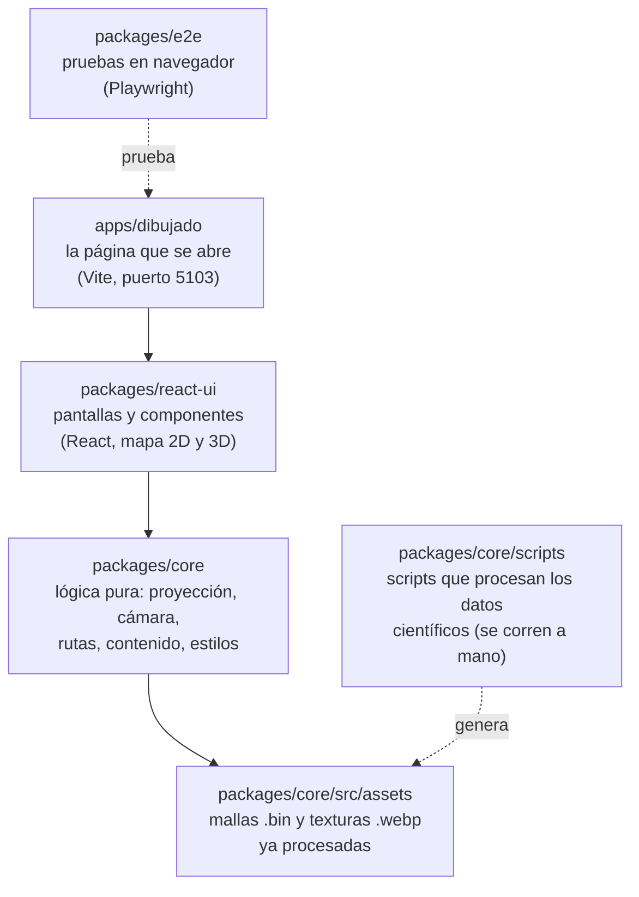

# Cómo está hecha Antártida por descubrir

Guía corta de las tecnologías del proyecto: qué librería dibuja cada cosa, de dónde salen los datos del mapa y qué pasa en el navegador cuando alguien abre la página.

Estado del repositorio al 13 de noviembre de 2026.

## Resumen

Antártida por descubrir es una **página web**. Todo corre en el navegador de quien la abre. No hay servidor propio ni base de datos: el servidor solo entrega archivos.

| Tema | Qué usamos |
|---|---|
| Lenguaje | TypeScript (JavaScript con tipos). Los efectos visuales del 3D están en GLSL. |
| Interfaz | **React 19**. |
| Mapa 2D | Una imagen WebP pintada en acuarela, con una capa SVG de contornos y textos encima. |
| Mapa 3D | **Three.js** sobre WebGL, manejado desde React con **React Three Fiber**. |
| Relieve | Datos científicos reales: Bedmap3 (Antártida) e IBCSO v2 (mar y Tierra del Fuego). |
| Construcción | Vite arma la página. pnpm maneja los paquetes. |
| Pruebas | Vitest para la lógica y Playwright para probar la página en un navegador. |

## Las piezas del proyecto

El código está dividido en tres paquetes y una aplicación. Cada uno tiene un trabajo. La regla es que la interfaz no hace cuentas de geografía: esas cuentas viven en `core`.

- **`apps/dibujado`**: la página en sí. Es casi vacía: un HTML y un archivo que monta la app de React.
- **`packages/react-ui`**: todo lo que se ve. El mapa 2D, el mapa 3D, las fichas, la expedición a Orcadas y el viaje desde Ushuaia.
- **`packages/core`**: TypeScript puro, sin React. Tiene la proyección del mapa, los límites de la cámara, las rutas, los textos con sus fuentes, los estilos CSS y los archivos de datos.
- **`packages/e2e`** y **`scripts/bench`**: pruebas en navegador y medición de rendimiento.

## El lenguaje: TypeScript

Todo el código está en **TypeScript 6**. TypeScript es JavaScript con tipos: el editor y el comando `pnpm typecheck` avisan si pasamos un número donde va un texto, antes de abrir la página. Al construir, se convierte en JavaScript común, que es lo que el navegador ejecuta.

- Los archivos `.ts` tienen lógica.
- Los archivos `.tsx` son componentes de React: mezclan TypeScript con etiquetas parecidas a HTML.
- Los archivos `*.glsl.ts` guardan **shaders**: pequeños programas en GLSL que corren en la placa de video y deciden el color de cada píxel del mapa 3D.

Para desarrollar hace falta Node.js 22 o más nuevo. El usuario final no necesita nada: solo un navegador.

## React: la interfaz

La app corre sobre **React 19**. React arma la pantalla a partir de componentes: el mapa, el botón 2D/3D, la leyenda, la ficha de un punto. Cuando cambia un dato, por ejemplo qué punto está abierto, React actualiza solo lo que cambió.

El componente principal es `AntarcticaApp` (`packages/react-ui/src/AntarcticaApp.tsx`). Decide qué pantalla mostrar (mapa o expedición), si el mapa está en 2D o 3D, y qué expediciones ya se completaron.

> **Por qué React y no Preact.** Al principio la app usaba Preact, una versión más liviana. Se pasó a React porque React Three Fiber, la librería del 3D, no funciona sobre Preact.

### Carga en partes

Para que la página abra rápido, no se baja todo junto. El código del 3D, la expedición a Orcadas y el panel del viaje se cargan aparte, recién cuando hacen falta (con `lazy()` e `import()`). El código del 3D se precarga en un momento libre del navegador, así el cambio a 3D es casi inmediato. El JavaScript inicial queda por debajo de 80 kB comprimido.

## Vite y pnpm: las herramientas de trabajo

**Vite** es la herramienta que sirve la página mientras programamos y la empaqueta para publicarla.

- `pnpm dev` levanta la página en `http://localhost:5103`. Al guardar un archivo, la página se actualiza sola.
- `pnpm build` genera la versión final: archivos HTML, JavaScript, CSS e imágenes listos para subir a cualquier hosting estático.

**pnpm** instala las librerías y une los paquetes del repositorio. Por eso un paquete importa a otro por su nombre, por ejemplo `@antartida/core`, y no con rutas largas.

No usamos Tailwind ni otro framework de estilos. El CSS está escrito a mano en `packages/core/src/styles/`. Las tipografías (Fraunces, Atkinson Hyperlegible, Caveat y otras) se instalan con `@fontsource`, así no dependemos de Google Fonts.

## La proyección: cómo se aplana la Tierra

Un mapa plano necesita una regla para pasar de latitud y longitud a un punto en la pantalla. Usamos la **proyección estereográfica polar**: el Polo Sur queda en el centro y Greenwich hacia arriba. Es la proyección habitual de los mapas antárticos.

El mapa vive en un cuadrado propio de **0 a 1000 unidades**. El Polo Sur está en (500, 500). Una unidad mide unos 8 km sobre la Antártida. La fórmula está en un solo lugar, `packages/core/src/projection.ts`:

- `project(lon, lat)` pasa de coordenadas geográficas al cuadrado del mapa.
- `unproject(x, y)` hace la cuenta inversa.

El 2D y el 3D usan la misma proyección. Por eso un punto como Marambio cae en el mismo lugar en las dos vistas, y el relieve 3D queda justo debajo de la costa dibujada.

> **Deformación esperable.** Esta proyección agranda lo que está lejos del polo. En el 3D, las tierras del hemisferio norte se ven muy estiradas (a 50° N, unas 8 veces). No es un error de los datos. Por eso el mundo se corta en 60° N.

## El plano 2D

El mapa 2D tiene dos capas superpuestas. La separación existe por rendimiento: al principio todo era SVG con filtros de acuarela, y el zoom se trababa.

### Capa 1: la acuarela, como imagen

El océano, el hielo, los halos y la cuadrícula se dibujan una sola vez, al construir el proyecto, y se guardan como imagen WebP. El script `pnpm map-raster` abre el diseño SVG en Chromium y lo fotografía en tres tamaños: 768, 2048 y 4096 píxeles.

- Primero se muestra la de 768 px (60 kB). El HTML la pide antes que nada, para que el mapa aparezca enseguida.
- Cuando el navegador está libre, baja una más nítida: 2048 px en celulares y 4096 px en computadoras.
- Si la conexión es lenta (2G/3G) o el usuario activó ahorro de datos, no se baja la nítida.

### Capa 2: la tinta, como SVG

Encima va un SVG sin filtros con los contornos de la costa, la ruta y los textos. Al ser vectorial, queda nítido con cualquier zoom. La costa sale de Natural Earth y se guarda ya proyectada en `packages/core/src/coastline.ts`.

### Zoom, marcadores y etiquetas

- El zoom y el arrastre mueven las dos capas juntas con una transformación CSS (`transform`). La placa de video hace el trabajo y no hay que redibujar nada.
- Los marcadores de los puntos son botones HTML comunes. Se pueden usar con teclado y lector de pantalla.
- Cuando dos marcadores quedan muy cerca, se agrupan en uno (`clustering.ts`). Al acercarse, se separan.
- Las etiquetas prueban un lado y después el otro. Si no entran, se ocultan (`labels.ts`).

El 2D es también la vista de respaldo: si el navegador no tiene WebGL, la app abre en 2D y no ofrece el botón de 3D.

## El mapa 3D

El 3D se dibuja con **WebGL**, la tecnología del navegador para usar la placa de video. Encima de WebGL usamos estas librerías, todas con licencia MIT:

| Librería | Qué hace en el proyecto |
|---|---|
| **Three.js** 0.187 | El motor 3D. Maneja mallas, texturas, materiales y la cámara. |
| **React Three Fiber** 9 | Permite escribir la escena 3D como componentes de React (`<Terrain/>`, `<Ocean/>`). Crea el lienzo con `<Canvas>`. |
| **drei** 10 | Piezas listas: la cámara con movimiento suave (`CameraControls`), líneas (`Line`), textos HTML sobre el 3D (`Html`) y el monitor de rendimiento. |
| **postprocessing** 6 y **@react-three/postprocessing** 3 | Efectos sobre la imagen final. Lo usamos para el trazo de tinta de los bordes (`InkEffect`). |

### Qué hay en la escena

- **Terreno antártico** (`Terrain.tsx`): una malla de triángulos hecha con el relieve real de Bedmap3. Las alturas se multiplican por 50 para que se lean; la leyenda lo dice.
- **Océano** (`Ocean.tsx`): un plano en el nivel del mar, coloreado según la profundidad real de IBCSO v2, con un oleaje suave.
- **Tierra del Fuego, Patagonia sur y Malvinas** (`Fuegia.tsx`): otra malla, también de IBCSO v2, con exageración ×10. Se descarga solo cuando la cámara se acerca a esa zona.
- **Resto del mundo** (`SouthernLands.tsx`): siluetas planas de Natural Earth hasta 60° N, sin relieve. Son contexto, no datos.
- **Fauna, témpanos, Irízar y Hércules** (`SeaLife.tsx`): modelos de bloques ilustrativos. La leyenda aclara que no son posiciones reales.
- **Cuadrícula, marcadores y escenas** de Ushuaia, Orcadas y el viaje.

### El aspecto dibujado: los shaders

El 3D no usa luces de Three.js. Cada superficie tiene un shader propio que pinta el estilo de cuaderno. El del terreno (`paintedTerrain.glsl.ts`) arma cada píxel en capas: la acuarela del 2D como base, tinte del hielo según la altura, luz desde el noroeste, sombras precalculadas, hachures en las laderas, curvas de nivel cada 250 m y grano de papel.

Las sombras y la oclusión se calculan una sola vez, al procesar los datos, y se guardan en una textura. Calcularlas en cada cuadro sería demasiado caro.

### Cómo se cuida el rendimiento

- **Dibujo a pedido:** el lienzo usa `frameloop="demand"`. Solo redibuja cuando algo se mueve. Con el mapa quieto, la placa de video descansa.
- **Un solo reloj de animación** a 30 cuadros por segundo para el mar y los animales. Se detiene en 2D, con la pestaña oculta o con movimiento reducido activado.
- **Calidad automática:** `PerformanceMonitor` mide los cuadros por segundo. Si el equipo no da abasto, baja la resolución y después apaga el trazo de tinta.
- **Dos tamaños de cada archivo:** los celulares (menos de 820 px de ancho) bajan mallas y texturas más livianas.

### La cámara y los gestos

La cámara es `CameraControls` de drei, con límites definidos en `packages/core/src/camera.ts`: inclinación máxima de 60° y un tope de alejamiento. Una prueba verifica que la cámara nunca vea más allá de las tierras dibujadas.

- Computadora: arrastrar mueve el mapa, la rueda acerca, el botón derecho gira e inclina.
- Celular: un dedo mueve; pellizcar acerca; girar dos dedos gira; subir dos dedos inclina. La regla de los gestos está en `core/src/gestures.ts`, con pruebas.

## Modelos de bloques (voxel)

Todos los animales, barcos, aviones y edificios son **modelos de bloques**. No usamos archivos 3D importados ni dibujos planos. Un modelo es una lista de cajas; cada caja tiene posición, tamaño y color:

`[centroX, centroY, centroZ, anchoX, altoY, largoZ, color]`

La función `buildBoxGeometry` (`packages/react-ui/src/voyage/vehicles.ts`) une todas las cajas en una sola pieza y pinta un sombreado fijo en cada cara. Así cada modelo se dibuja de una vez y no necesita luces.

- Cada modelo tiene al menos 12 cajas y 2 colores, más su rasgo propio (ojos, ventanas, techo). Una prueba lo controla.
- De cerca mantienen su tamaño en pantalla para no tapar el mapa. De lejos se achican, y por debajo de cierto tamaño se ocultan.
- Son ilustraciones con tamaño exagerado, no datos.

Detalle completo en [`docs/diseno/estilo-voxel.md`](diseno/estilo-voxel.md).

## Qué descargamos y cómo lo procesamos

Los datos científicos originales son muy pesados para una página web. El proceso tiene tres pasos:

1. **Alguien del equipo descarga los archivos originales una vez** a una carpeta de su computadora (`~/.cache/antartida3d/`). No se suben a GitHub.
2. **Un script los procesa** (`packages/core/scripts/`). Cambia la proyección a la del mapa, reduce el detalle donde el terreno es plano y genera archivos chicos.
3. **Los archivos chicos sí se suben al repositorio** (`packages/core/src/assets/`, unos 32 MB). Así cualquiera clona el proyecto y lo usa sin bajar nada más.

| Dato original | Quién lo publica | Qué bajamos | Para qué | Script |
|---|---|---|---|---|
| **Bedmap3** | British Antarctic Survey · CC BY 4.0 | 2 archivos, 690 MB | Altura y tipo de superficie (hielo, roca, barrera flotante) de toda la Antártida, a 500 m | `pnpm terrain` |
| **IBCSO v2** | SCAR / Alfred Wegener Institute · CC BY 4.0 | ~160 MB | Profundidad del mar al sur de 50° S, y el relieve de Tierra del Fuego y Malvinas | `pnpm bathymetry`, `fuegia` |
| **Natural Earth** (vectores) | Natural Earth · dominio público | chico | Costa 2D, barreras de hielo y siluetas del resto del mundo | `pnpm coastline` |
| **Natural Earth II** (imagen) | Natural Earth · dominio público | 40 MB | Color del suelo de las tierras del resto del mundo | `southern-lands-color` |

Las librerías que usan los scripts son solo de desarrollo y no llegan al usuario: `geotiff` lee los archivos de relieve, `proj4` convierte entre proyecciones, `@mapbox/martini` arma la malla de triángulos, `sharp` escribe las imágenes WebP y `d3-geo` proyecta la costa.

### Malla adaptativa

Una grilla de alturas uniforme sería enorme. Martini convierte la grilla en triángulos de tamaño variable: muchos donde el relieve cambia (cordilleras, costas) y pocos donde es plano (la meseta polar). Se descartan los triángulos que son solo océano. Las mallas se guardan en un formato binario propio (`.bin`) que lee `parseTerrainMesh` en `core/src/terrain.ts`.

> **Cuidado con el historial de git.** Cada vez que se regeneran y suben estos archivos, git guarda otra copia de unos 27 MB que no se borra. Regenerar solo si cambia algo de fondo: la costa, la proyección, la exageración o el formato.

Fuentes, citas y licencias completas en [`docs/datos-relieve.md`](datos-relieve.md) y en el [`README.md`](../README.md).

## Qué baja el usuario al abrir la página

El navegador descarga solo lo que necesita, en este orden:

| Momento | Qué se baja | Peso aproximado |
|---|---|---|
| Al abrir | HTML, JavaScript inicial, CSS, tipografías y la acuarela de 768 px | ~76 kB de JS comprimido + 60 kB de imagen |
| Con el navegador libre | Acuarela nítida (2048 o 4096 px) y el código del 3D | 172 o 560 kB de imagen |
| Al entrar al 3D, celular | Malla liviana y textura de relieve de 2048 px | ~6,6 MB |
| Al entrar al 3D, computadora | Malla detallada y textura de relieve de 4096 px | ~19 MB |
| Al acercarse a Tierra del Fuego | Malla de Tierra del Fuego | 0,8 a 1,4 MB comprimido |

Los pesos del 3D corresponden al relieve antártico; el mar y las tierras lejanas suman algunas texturas más. Después de la primera visita, el navegador guarda todo en caché.

## Qué se guarda en el navegador

No hay cuentas ni servidor, así que no se guarda nada fuera del dispositivo. La app usa `localStorage` del navegador para dos cosas:

- qué expediciones completó la persona (`antartida:explored`);
- si prefiere la vista 2D o 3D (`antartida:view`).

Si el navegador bloquea el guardado (por ejemplo, en modo incógnito), la app sigue funcionando y solo pierde el recuerdo al cerrar (`core/src/storage.ts`).

La vista inicial se elige así: si hay una elección guardada, se usa. Si no, abre en 3D, salvo que no haya WebGL, que la persona pida movimiento reducido o que tenga activado el ahorro de datos.

## Pruebas y medición

| Comando | Herramienta | Qué controla |
|---|---|---|
| `pnpm test` | Vitest | La lógica de `core`: proyección, alturas del relieve, límites de cámara, gestos, rutas que no cruzan tierra. También el mínimo de detalle de los modelos de bloques. |
| `pnpm typecheck` | TypeScript | Que los tipos coincidan en todo el repositorio. |
| `pnpm e2e` | Playwright + Chromium | Abre la página real a 390 px (celular) y 1440 px (computadora) y recorre los flujos. Falla ante cualquier error en la consola. |
| `pnpm bench` | Lighthouse + scripts propios | Peso, tiempo de carga, accesibilidad y fluidez del zoom. El resultado queda en [`docs/rendimiento.md`](rendimiento.md). |

## Glosario

- **WebGL:** la forma en que una página web usa la placa de video para dibujar en 3D.
- **Shader:** programa chico que corre en la placa de video y decide el color de cada píxel o la posición de cada punto.
- **Malla:** superficie 3D hecha de triángulos. El terreno es una malla.
- **Textura:** imagen que se pega sobre una malla. A veces guarda colores; a veces, datos como la inclinación o la sombra.
- **Proyección:** regla para pasar de la Tierra redonda a un plano.
- **WebP:** formato de imagen más liviano que PNG o JPG.
- **GeoTIFF:** imagen con información geográfica. Los datos científicos de relieve vienen en este formato.
- **Exageración vertical:** multiplicar las alturas para que el relieve se note. La Antártida mide 4500 km de ancho y menos de 5 km de alto.
- **Carga diferida:** bajar una parte del código recién cuando se necesita.

---

Basado en el código y la documentación del repositorio (`docs/decisiones.md`, `docs/datos-relieve.md`, `docs/diseno/estilo-voxel.md`, `README.md`). Redactado con asistencia de IA.
